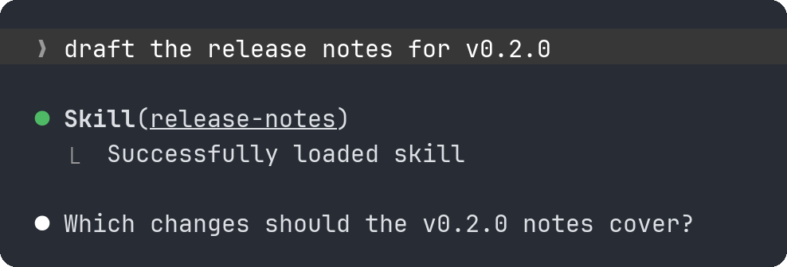

# skill-links

A Claude Code mod that turns the skill name in a `Skill(...)` tool row into a link to that skill's `SKILL.md`. Click the name the way your terminal opens links (Ctrl-click in most terminals, Cmd-click in iTerm2) to open the file.



Clicking `release-notes` opens `.claude/skills/release-notes/SKILL.md`.

## Install

At the prompt of a Claude Code session in a terminal:

```
/plugin install skill-links --marketplace vdvoorder/claude-code-skill-links
```

From a shell:

```
claude plugin install skill-links --marketplace vdvoorder/claude-code-skill-links
```

Answer `y` to add the marketplace, then pick a scope. The mod is active right away.

## How it works

- When a skill loads, Claude Code passes the mod the path of the skill's file. The mod keeps a list of skill names and paths, and the list carries over to later sessions.
- In an organization-managed Claude Code, that event does not reach plugins a person installs. The mod then looks for the file itself after each `Skill` call, in this order:
  - `.claude/skills/<name>/SKILL.md` and `.claude/commands/<name>.md` in the project;
  - the same two paths in the Claude Code config folder (`CLAUDE_CONFIG_DIR`, or `~/.claude`);
  - for a plugin skill (`plugin:name`), the installed version listed in `plugins/installed_plugins.json` in the config folder.
- Once a `Skill` call has finished successfully, the mod draws the row with the name as a link. A call that is still running, failed or was interrupted keeps the row Claude Code draws.

## Limitations

- The mod only draws a link in a terminal it knows supports links: `FORCE_HYPERLINK` set to a value other than `0`, Windows Terminal, iTerm2 3.1 or later, WezTerm, VS Code 1.72 or later, Ghostty, and VTE-based terminals such as GNOME Terminal. In any other terminal the row stays as Claude Code draws it, because Claude Code would print the full file address after the name and wrap the row.
- If your terminal supports links but is not on that list (kitty, Alacritty, tmux with hyperlinks enabled), set `FORCE_HYPERLINK` to `1` in the `env` block of your Claude Code `settings.json`. Claude Code then also prints its own links as hyperlinks.
- Over SSH, the link points to the file on the machine where Claude Code runs, so a click on your own computer opens nothing.
- Only the terminal is changed. The desktop app and the VS Code extension keep their own rows.
- Built-in skills and skills from MCP servers have no file on disk, so their rows stay plain.
- Claude Code's mod API is in early access and can change between releases. This version was tested with Claude Code 2.1.302 and 2.1.303.

## What it reads

- Environment variables `CLAUDE_CONFIG_DIR`, `USERPROFILE` and `HOME`, to find the config folder.
- Environment variables `FORCE_HYPERLINK`, `WT_SESSION`, `TERM_PROGRAM`, `TERM_PROGRAM_VERSION` and `VTE_VERSION`, to decide whether the terminal supports links.
- Whether the skill files listed above exist, and the contents of `plugins/installed_plugins.json`.

The mod stores one thing: the list of skill names and file paths, in Claude Code's plugin store inside the config folder. It sends nothing anywhere.

## Development

Load the mod from a checkout for one session:

```
claude --plugin-dir /path/to/claude-code-skill-links
```

Check the manifest and hooks, and run the tests:

```
claude plugin validate .
claude plugin test .
```

See [CONTRIBUTING.md](CONTRIBUTING.md) for issues and pull requests.

## License

[MIT](LICENSE)
